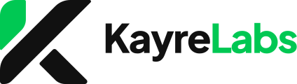

# KayreLabs — Guía de marca

Resumen de la identidad de KayreLabs reunido a partir del sitio web (<https://www.kayrelabs.com>) y de su repositorio (`CaiRe111/kayrelabs`, rama `main`, commit `205e51c`). Generado el 17 de octubre de 2026.



Esta carpeta reúne este documento y todos los archivos gráficos de la marca: logotipos, iconos, ilustraciones, fondos, tipografías y recursos para web y redes. Los SVG son los originales del sitio. Los PNG de `01-logotipos/png` y los de 1024 px de `02-app-redes-y-web/png` son exportaciones hechas a partir de esos SVG, con fondo transparente.

## ¿Qué archivo uso?

| Necesito… | Archivo |
|---|---|
| Logotipo en Word, PowerPoint, Canva o redes | `01-logotipos/png/logo-horizontal-2000px.png` (fondo claro) o `logo-horizontal-negativo-2000px.png` (fondo oscuro) |
| Logotipo para imprenta, rotulación o edición vectorial | `01-logotipos/svg/` |
| Foto de perfil en redes | `02-app-redes-y-web/png/icon-512.png`, o `icon-maskable-512.png` si prefieres sin esquinas redondeadas |
| Imagen al compartir el enlace del sitio | `02-app-redes-y-web/png/og-image.png` (1200 × 630 px) |
| Iconos de la app y del navegador | `02-app-redes-y-web/` |
| Tipografías | Plus Jakarta Sans y JetBrains Mono (sección 4) |
| Colores | Sección 3 |

## 1. La marca en breve

| | |
|---|---|
| **Nombre** | KayreLabs (junto, con K y L mayúsculas) |
| **Qué es** | Laboratorio creativo de impresión 3D, electrónica, domótica, desarrollo y diseño |
| **Título del sitio** | KayreLabs — Diseño y Tecnología |
| **Frase de portada** | Donde el diseño se encuentra con la tecnología |
| **Atributos** | Minimalista · Adaptable · Futura |
| **Concepto del logotipo** | «Una K con proyección» |
| **Áreas** | Impresión 3D · Electrónica · Domótica · Desarrollo · Diseño |
| **Sitio web** | <https://www.kayrelabs.com> |
| **Correo** | kayrelabs.contacto@gmail.com |
| **Instagram** | <https://www.instagram.com/kayrelabs/> |
| **Facebook, X y YouTube** | Pendientes: los iconos están en el sitio, pero aún sin URL |

Los tres atributos, tal como los describe el sitio:

- **Minimalista:** formas suaves y directas, sin ruido.
- **Adaptable:** funciona en cualquier tamaño, formato o aplicación.
- **Futura:** ideas pensadas para crecer y proyectarse.

Texto de presentación (sección «Sobre KayreLabs»): **Creatividad con proyección.** «Un laboratorio donde combino diseño, electrónica, programación, impresión 3D y domótica para crear piezas que se ven bien y funcionan mejor.»

## 2. Logotipo

### 2.1 Concepto

«Una K estilizada con formas suaves y directas, que transmite creatividad, adaptabilidad y proyección. Su diseño minimalista funciona en cualquier tamaño, formato o aplicación, manteniendo la esencia de la marca sin perder legibilidad.»

### 2.2 Construcción

La K del isotipo se arma con tres piezas de bordes suaves, que son las mismas que nombran los SVG:

- **`hoja`** — verde. Es la parte superior del tallo de la K.
- **`k-banda`** — negra. Une el tallo inferior con el trazo diagonal ascendente.
- **`k-pata`** — negra. Bloque diagonal descendente que hace de pata de la K.

El nombre se escribe **KayreLabs**: «Kayre» en negro (o en blanco sobre fondo oscuro) y «Labs» en verde, en **Plus Jakarta Sans ExtraBold**. En los SVG las letras ya están convertidas a trazos, así que no hace falta tener la fuente instalada.

### 2.3 Versiones

| Versión | SVG original | PNG exportado | Úsala sobre |
|---|---|---|---|
| Logotipo principal | `logo-horizontal.svg` | `logo-horizontal-2000px.png` | Fondo blanco o claro |
| Logotipo en negativo | `logo-horizontal-negativo.svg` | `logo-horizontal-negativo-2000px.png` | Fondo negro u oscuro |
| Isotipo a color | `isotipo.svg` | `isotipo-1000px.png` | Fondo claro |
| Isotipo en negativo | `isotipo-negativo.svg` | `isotipo-negativo-1000px.png` | Fondo oscuro |
| Icono monocromático (negro) | `icono-monocromo.svg` | `icono-monocromo-1000px.png` | Una sola tinta sobre fondo claro |
| Icono monocromático (blanco) | `icono-monocromo-blanco.svg` | `icono-monocromo-blanco-1000px.png` | Una sola tinta sobre fondo oscuro o sobre verde |
| Isotipo app · verde | `isotipo-app-verde.svg` | `isotipo-app-verde-1024px.png` | App, favicon, perfil |
| Isotipo app · negro | `isotipo-app-negro.svg` | `isotipo-app-negro-1024px.png` | App o perfil sobre negro |

Las seis primeras filas están en `01-logotipos/svg/` (SVG) y `01-logotipos/png/` (PNG). Los dos isotipos de app están en `02-app-redes-y-web/svg/` y `02-app-redes-y-web/png/`.

Los isotipos de app son un cuadrado de esquinas redondeadas (radio del 22 % del lado) con la K centrada: en blanco sobre verde, o con la hoja verde y la K blanca sobre negro.

Proporciones de los archivos: isotipo 130,17 × 120,8 (casi cuadrado); logotipo horizontal 424,8 × 120,8 (unas 3,5 veces más ancho que alto).

### 2.4 Espacio libre y tamaño mínimo

- **Espacio libre:** alrededor del logotipo, como mínimo el ancho de la hoja verde de la K (unos 28 % del ancho del isotipo).
- **Tamaño mínimo:** 24 px de alto para el isotipo y 120 px de ancho para el logotipo horizontal.

### 2.5 Uso correcto

**Sí**

- Logotipo principal sobre fondo blanco o claro; versión en negativo sobre negro.
- Respetar el espacio libre y el tamaño mínimo.
- Verde para acentos, iconos y botones, con texto negro encima.

**No**

- No deformes, inclines ni cambies las proporciones del logotipo.
- No cambies los colores de la K ni de «Labs».
- No uses el logotipo en negativo sobre verde: «Labs» se pierde. Usa el isotipo blanco o el monocromático.
- No lo coloques sobre fotos con mucho detalle sin una capa oscura.

## 3. Color

### 3.1 Paleta oficial

| Color | HEX | RGB | HSL | CMYK aprox. | Uso |
|---|---|---|---|---|---|
| Verde principal | `#00C853` | 0, 200, 83 | 145°, 100 %, 39 % | 100, 0, 59, 22 | Acentos, iconos, botones, «Labs» |
| Negro principal | `#111111` | 17, 17, 17 | 0°, 0 %, 7 % | 0, 0, 0, 93 | Texto, logotipo, fondos oscuros |
| Blanco / fondo | `#FFFFFF` | 255, 255, 255 | 0°, 0 %, 100 % | 0, 0, 0, 0 | Fondo, texto sobre oscuro |

El CMYK es una conversión simple a partir del RGB y sirve solo de referencia. Para imprenta, pide una prueba de color y confirma los valores con el taller.

### 3.2 Colores derivados (solo para interfaz)

| Color | HEX | Uso |
|---|---|---|
| Verde para texto | `#007A33` | Texto pequeño sobre fondo claro, etiquetas superiores, enlaces al pasar el ratón |
| Verde tinte | `#E8FAF0` | Fondo suave de las cajas de iconos y de las etiquetas |
| Gris 50 | `#F6F8F7` | Secciones alternas de fondo claro |
| Gris 200 | `#E3E8E5` | Bordes y separadores |
| Gris 600 | `#5D6762` | Texto secundario sobre fondo claro |
| Gris 300 (sobre oscuro) | `#B8C0BB` | Texto secundario sobre negro |
| Texto general sobre oscuro | `#EEF2F0` | Texto en secciones de fondo negro |
| Verde de enlace al pasar el ratón (sobre oscuro) | `#5DF0A2` | Enlaces en secciones de fondo negro |

### 3.3 Contraste (WCAG 2.x)

Calculado con la fórmula de contraste de las pautas WCAG. El texto normal necesita al menos 4,5:1 (nivel AA).

| Texto | Fondo | Contraste | ¿Sirve para texto? |
|---|---|---|---|
| `#111111` | `#FFFFFF` | 18,9:1 | Sí |
| `#FFFFFF` | `#111111` | 18,9:1 | Sí |
| `#111111` | `#00C853` | 8,4:1 | Sí (texto de botones) |
| `#00C853` | `#111111` | 8,4:1 | Sí |
| `#00C853` | `#FFFFFF` | 2,2:1 | **No** (solo decorativo) |
| `#FFFFFF` | `#00C853` | 2,2:1 | **No**: sobre verde usa texto negro |
| `#007A33` | `#FFFFFF` | 5,5:1 | Sí |
| `#007A33` | `#F6F8F7` | 5,1:1 | Sí |
| `#007A33` | `#E8FAF0` | 5,1:1 | Sí |
| `#5D6762` | `#FFFFFF` | 5,9:1 | Sí |
| `#5D6762` | `#F6F8F7` | 5,5:1 | Sí |
| `#B8C0BB` | `#111111` | 10,2:1 | Sí |
| `#EEF2F0` | `#111111` | 16,7:1 | Sí |
| `#5DF0A2` | `#111111` | 13,0:1 | Sí |

### 3.4 Reglas de uso

- El verde principal es para acentos, iconos y botones; el texto que va encima es negro.
- Para texto pequeño sobre blanco usa negro o el verde oscuro `#007A33`, nunca el verde principal.
- Los titulares suelen resaltar una palabra clave en verde (por ejemplo «tecnología» en la imagen para compartir).
- Los colores se cambian en un solo sitio del código: `scss/_marca.scss` (hay una copia en `07-referencia-codigo`).

## 4. Tipografía

| Familia | Rol | Dónde se usa | Pesos |
|---|---|---|---|
| **Plus Jakarta Sans** | Marca | Logotipo, títulos, menús y texto general | Variable de 200 a 800. Títulos 800, botones 700, menús 600, texto 400 |
| **JetBrains Mono** | Técnica | Electrónica y Desarrollo: títulos, tarjetas de terminal, etiquetas | Variable de 100 a 800. Títulos de cabecera 700 |
| **Serif cursiva** (Georgia, o Times New Roman) | Arte | Solo la página de Diseño: títulos y pies de foto | Cursiva, peso normal |

Reglas de texto del sitio:

- **Títulos:** peso 800, interlineado 1,1 y espaciado entre letras de −0,03 em.
- **Etiqueta superior** (sobre los títulos de sección): mayúsculas, 0,78 rem, peso 700, espaciado de 0,2 em, color verde `#007A33`.
- **Páginas técnicas** (Electrónica y Desarrollo): el título lleva el prefijo `$ ` y un cursor `_` verde que parpadea.

Pilas de fuentes (de `scss/_marca.scss`):

```scss
$fuente-base: "Plus Jakarta Sans", system-ui, -apple-system, "Segoe UI", Roboto, sans-serif;
$fuente-tech: "JetBrains Mono", ui-monospace, "Cascadia Code", Consolas, monospace;
$fuente-arte: Georgia, "Times New Roman", serif;
```

**Archivos y licencia.** En `03-tipografia/` están los `.woff2` que usa el sitio (subconjunto latino, que incluye tildes y la ñ) y sus licencias. Las dos familias son libres bajo la licencia SIL Open Font License 1.1, que permite uso comercial. Los `.woff2` sirven para web: para instalarlas en el computador (Word, Canva, Figma…) descarga las familias completas de Google Fonts:

- Plus Jakarta Sans: <https://fonts.google.com/specimen/Plus+Jakarta+Sans>
- JetBrains Mono: <https://fonts.google.com/specimen/JetBrains+Mono>

## 5. Forma, interfaz y texturas

| Elemento | Regla |
|---|---|
| Esquinas | Suaves («formas suaves y directas»): radio de 0,75 rem y de 1,1 rem en tarjetas grandes |
| Botón principal | Fondo verde `#00C853`, texto negro, peso 700 |
| Enlaces | Texto negro; al pasar el ratón, verde `#007A33` (sobre oscuro: verde `#00C853` y luego `#5DF0A2`) |
| Foco con teclado | Contorno verde de 3 px, con 3 px de separación |
| Selección de texto | Fondo verde con texto negro |
| Cabecera de página | Fondo negro con brillo verde y retícula de puntos; texto blanco |
| Secciones | Alternan blanco y gris claro `#F6F8F7` |
| Caja de icono | Cuadrado de 3,5 rem con fondo verde tinte `#E8FAF0` e icono verde |
| Tarjetas de área (Inicio) | Borde gris claro. Al pasar el ratón pasan a **negativo** (fondo negro, texto blanco, acento verde), se elevan 4 px y su textura **se expande** |
| Tarjetas de terminal | Electrónica, Desarrollo e Impresión 3D: fondo negro, borde verde, esquinas cortadas en diagonal (20 px), barra superior con tres puntos y la categoría entre corchetes |
| Marcos de foto | Diseño: borde blanco, sombra y un giro leve que se alterna entre fotos |

**Textura de cada área en las tarjetas de Inicio.** Se hacen solo con CSS (no son archivos): Impresión 3D, líneas horizontales finas como capas de filamento; Electrónica, rejilla con puntos en los cruces, como una placa; Domótica, ondas concéntricas de señal desde una esquina; Desarrollo, matriz de puntos; Diseño, trama diagonal de grabado. Son de verde suave sobre blanco y pasan a blanco sobre negro al pasar el ratón, con una expansión del 18 %.

## 6. Recursos gráficos

### 6.1 Iconos de línea (`04-iconos/`)

Quince iconos de 24 × 24 px con trazo de 1,75 px. En el archivo son verdes (`#00C853`); en el sitio se usan como máscara, así que toman el color del texto.

| Icono | Dónde se usa |
|---|---|
| `impresion-3d`, `electronica`, `domotica`, `desarrollo`, `diseno` | Las cinco áreas |
| `regla`, `capas`, `engranaje` | Servicios de Impresión 3D: piezas a medida, prototipos, repuestos y reparaciones |
| `bombillo`, `sensor`, `celular` | Servicios de Domótica: iluminación, sensores, control desde el celular |
| `correo`, `celular` | Página de contacto |
| `flecha` | Enlaces y botones |
| `check`, `descargar` | Guía de marca del sitio |

### 6.2 Ilustraciones por área (`05-ilustraciones/`)

Cinco ilustraciones de línea de 480 × 420 en blanco, verde y negro, una por área. Van en la cabecera de la página de cada área.

- **`impresion-3d`:** impresora con un cubo en capas sobre una plataforma isométrica.
- **`electronica`:** chip con la K y pistas de circuito.
- **`domotica`:** casa con señal wifi y cuatro iconos conectados (luz, temperatura, celular y candado).
- **`desarrollo`:** ventana de editor con líneas de código, una terminal y un botón verde `</>`.
- **`diseno`:** la K en construcción: la hoja verde seleccionada con sus puntos de control, curvas Bézier y una paleta de cuatro círculos.

### 6.3 Fondos y patrones (`06-fondos-y-patrones/`)

| Archivo | Dónde se usa |
|---|---|
| `patron-isometrico.svg` | Cabecera de Impresión 3D (mosaico) |
| `patron-circuito.svg` | Cabecera de Electrónica (mosaico) |
| `red-nodos.svg` | Cabecera de Domótica |
| `curvas-vectoriales.svg` | Cabecera de Diseño |
| `marca-agua-k.svg` | Cabecera compacta de Contacto y de la guía de marca: la K grande y tenue |
| `marca-agua-k-negra.svg` | Banda verde de llamada a la acción: la K tono sobre tono |

La cabecera de Desarrollo usa una rejilla hecha con CSS, sin archivo.

## 7. Identidad en web, apps y redes (`02-app-redes-y-web/`)

| Archivo | Tamaño | Uso |
|---|---|---|
| `svg/favicon.svg` | Vectorial | Icono de la pestaña del navegador |
| `favicon.ico` | 16, 32 y 48 px | Navegadores antiguos |
| `png/apple-touch-icon.png` | 180 × 180 | Icono al guardar el sitio en la pantalla de inicio del iPhone o iPad |
| `png/icon-192.png`, `png/icon-512.png` | 192 y 512 px | Iconos de la app web; el de 512 px es también la foto de perfil recomendada para redes |
| `png/icon-maskable-512.png` | 512 × 512 | Icono «maskable» de Android (el sistema lo recorta; no tiene esquinas redondeadas) |
| `png/og-image.png` | 1200 × 630 | Imagen que aparece al compartir el enlace del sitio |
| `svg/isotipo-app-verde.svg`, `svg/isotipo-app-negro.svg` | Vectorial | Originales de los iconos de app (más los PNG de 1024 px) |

La imagen para compartir muestra el logotipo en negativo, la dirección web, el lema «Minimalista · Adaptable · Futura», el titular «Donde el diseño se encuentra con la tecnología» con «tecnología» en verde, y las cinco áreas como etiquetas con su icono.

Datos de la app web (`07-referencia-codigo/site.webmanifest`): nombre «KayreLabs», color de tema `#00C853`, color de fondo `#FFFFFF`, idioma español.

## 8. Voz y textos

Lo siguiente está observado en los textos del sitio; no es una norma escrita en el repositorio.

- Español, tuteo y primera persona: «Cuéntame tu idea y la convertimos en algo real».
- Frases cortas y directas, con verbos de acción.
- Titulares con una palabra clave resaltada en verde.

| Área | Descripción corta | Titular de su página |
|---|---|---|
| Impresión 3D | Piezas a medida, prototipos y repuestos: del modelo digital al objeto físico. | Del modelo digital al objeto físico |
| Electrónica | Circuitos, placas y prototipos con microcontroladores. | `$ electronica_` |
| Domótica | Automatiza tu hogar: iluminación, sensores y control desde el celular. | Tu hogar, conectado y a tu medida |
| Desarrollo | Código, aplicaciones web y software a la medida. | `$ desarrollo_` |
| Diseño | Identidad visual, ilustración, fotografía y audiovisual. | Diseño gráfico & Audiovisual |

Otros textos fijos:

- **Portada:** «Donde el diseño se encuentra con la tecnología». Subtítulo: «Impresión 3D, electrónica, domótica, desarrollo y diseño en un solo laboratorio creativo».
- **Llamada a la acción:** «¿Tienes una idea? Construyámosla.» y «¿Tienes un proyecto en mente?».
- **Contacto:** «Hablemos».
- **Pie de página:** «Laboratorio creativo de impresión 3D, electrónica, domótica, desarrollo y diseño».

## 9. Contenido de esta carpeta

```text
docs/marca/
├── 01-logotipos/   ← Logotipo horizontal, isotipo e icono monocromático (SVG y PNG)
│   ├── png/
│   │   ├── icono-monocromo-1000px.png
│   │   ├── icono-monocromo-blanco-1000px.png
│   │   ├── isotipo-1000px.png
│   │   ├── isotipo-negativo-1000px.png
│   │   ├── logo-horizontal-2000px.png
│   │   └── logo-horizontal-negativo-2000px.png
│   └── svg/
│       ├── icono-monocromo-blanco.svg
│       ├── icono-monocromo.svg
│       ├── isotipo-negativo.svg
│       ├── isotipo.svg
│       ├── logo-horizontal-negativo.svg
│       └── logo-horizontal.svg
├── 02-app-redes-y-web/   ← Isotipos de app, favicon, iconos e imagen para compartir
│   ├── png/
│   │   ├── apple-touch-icon.png
│   │   ├── icon-192.png
│   │   ├── icon-512.png
│   │   ├── icon-maskable-512.png
│   │   ├── isotipo-app-negro-1024px.png
│   │   ├── isotipo-app-verde-1024px.png
│   │   └── og-image.png
│   ├── svg/
│   │   ├── favicon.svg
│   │   ├── isotipo-app-negro.svg
│   │   └── isotipo-app-verde.svg
│   └── favicon.ico
├── 03-tipografia/   ← Fuentes web (.woff2) y sus licencias
│   ├── LICENSE-jetbrains-mono.txt
│   ├── LICENSE-plus-jakarta-sans.txt
│   ├── jetbrains-mono-latin-wght-normal.woff2
│   └── plus-jakarta-sans-latin-wght-normal.woff2
├── 04-iconos/   ← 15 iconos de línea
│   ├── bombillo.svg
│   ├── capas.svg
│   ├── celular.svg
│   ├── check.svg
│   ├── correo.svg
│   ├── desarrollo.svg
│   ├── descargar.svg
│   ├── diseno.svg
│   ├── domotica.svg
│   ├── electronica.svg
│   ├── engranaje.svg
│   ├── flecha.svg
│   ├── impresion-3d.svg
│   ├── regla.svg
│   └── sensor.svg
├── 05-ilustraciones/   ← Una ilustración por área
│   ├── desarrollo.svg
│   ├── diseno.svg
│   ├── domotica.svg
│   ├── electronica.svg
│   └── impresion-3d.svg
├── 06-fondos-y-patrones/   ← Fondos, patrones y marcas de agua
│   ├── curvas-vectoriales.svg
│   ├── marca-agua-k-negra.svg
│   ├── marca-agua-k.svg
│   ├── patron-circuito.svg
│   ├── patron-isometrico.svg
│   └── red-nodos.svg
├── 07-referencia-codigo/   ← Colores y tipografías en SCSS, y datos de la app web
│   ├── _marca.scss
│   └── site.webmanifest
├── MARCA-KAYRELABS.md
└── MARCA-KAYRELABS.pdf
```

## 10. Lo que esta carpeta no incluye

- **Fotos, ilustraciones y logotipos de muestra de la galería de Diseño** (`public/assets/img/`): son piezas del portafolio, no de la marca. Los `logo.png`, `logo1.png` y `logo2.png` de esa carpeta son ejemplos de la galería, no de KayreLabs.
- **Retrato del creador** (`Portada-1.jpeg`) y los **videos y capturas de proyectos** (`public/assets/media/`).
- **Iconos de redes sociales del pie del sitio** (`public/assets/img/Icon/`): los archivos llevan el aviso «Font Awesome Pro 6.2.1 … Commercial License», es decir, son de terceros con licencia comercial, y no se redistribuyen en este kit.
- **Fuentes instaladas (TTF u OTF):** solo están los `.woff2` del sitio; descárgalas de Google Fonts (sección 4).
- **Manual de marca original:** no hay ninguno en el repositorio. Si existe (PDF, Figma…), está fuera de él.
- **URLs de Facebook, X y YouTube:** pendientes.

## 11. Para quien edita el sitio

- **Dónde vive esta carpeta:** en `docs/marca/` del repositorio. No se publica en el sitio (el sitio solo publica `public/`). Los archivos son copias: si cambias un logotipo, icono, fondo o fuente en `public/assets/`, actualiza también la copia de aquí.
- Los colores, las tipografías y los radios viven en `scss/_marca.scss` (copia en `07-referencia-codigo/`). Después de editarlo, ejecuta `npm run build` para regenerar `public/css/style.css`.
- Los logotipos, iconos y fondos originales están en `public/assets/brand/`, `public/assets/iconos/`, `public/assets/ilustraciones/` y `public/assets/fondos/`.
- La guía visual en línea es `public/marca.html` (<https://www.kayrelabs.com/marca.html>).
- Valores de la paleta, para copiar:

```scss
$kl-verde: #00c853;
$kl-negro: #111111;
$kl-blanco: #ffffff;
$kl-verde-texto: #007a33;
$kl-verde-tinte: #e8faf0;
$kl-gris-50: #f6f8f7;
$kl-gris-200: #e3e8e5;
$kl-gris-600: #5d6762;
$kl-gris-300-oscuro: #b8c0bb;
```
